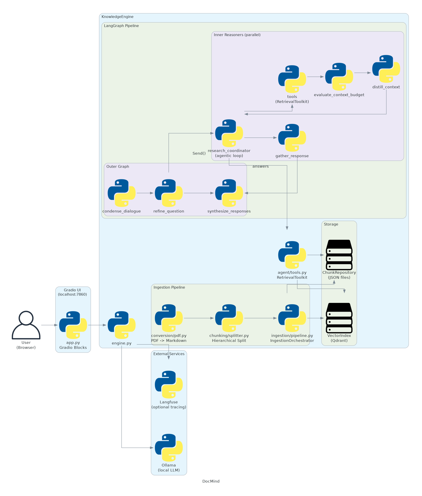

<p align="center"></p>

<h1 align="center">DocMind</h1>
<p align="center">An intelligent document assistant powered by agentic RAG with hierarchical chunking and hybrid search.</p>

<p align="center">
  
  
  
  
  
  
</p>

<p align="center">
  <a href="#what-it-does">What it does</a> •
  <a href="#architecture">Architecture</a> •
  <a href="#getting-started">Getting started</a> •
  <a href="#configuration">Configuration</a> •
  <a href="#design-decisions">Design decisions</a> •
  <a href="#observability">Observability</a> •
  <a href="#local-development">Local development</a> •
  <a href="#known-limitations">Known limitations</a> •
  <a href="#license">License</a>
</p>

---

## What it does

DocMind lets you upload PDF and Markdown documents, then ask natural language questions against them. Unlike naive RAG, it uses a two-tier agentic reasoning pipeline:

- The **outer graph** condenses conversation history, refines your question, and fans it out to parallel sub-agents.
- Each **inner reasoner** runs an agentic loop: searches the knowledge base with hybrid retrieval, manages a token budget, compresses context when needed, and produces a grounded answer.
- Answers from all sub-agents are synthesized into a single streamed response.

This makes DocMind effective at multi-faceted questions, follow-up queries, and questions where a single retrieval pass would miss context.

<!-- TODO: record a short screen capture of the chat interface in action and save as assets/demo.gif -->

---

## Architecture

<p align="center"></p>

**Component summary:**

| Component | Role |
|-----------|------|
| Gradio UI | Browser interface; document upload and streaming chat |
| `KnowledgeEngine` | Composition root; wires all components together |
| `IngestionOrchestrator` | Converts PDFs, splits documents, writes to storage |
| `HierarchicalSplitter` | Heading-aware splitting into parent/child segments |
| `VectorIndex` (Qdrant) | Hybrid dense+sparse vector search |
| `ChunkRepository` | JSON file store for parent segments |
| LangGraph pipeline | Two-tier agentic reasoning (outer + inner graphs) |
| `RetrievalToolkit` | LangChain tools passed to the inner reasoner agents |
| `TracingBridge` | Optional Langfuse integration for LLM observability |
| Ollama | Local LLM hosting (model pulled at startup) |

Data flows from uploaded file through ingestion and into Qdrant + file storage. At query time, the LangGraph pipeline retrieves from those stores and streams an answer to the UI.

---

## Getting started

### Prerequisites

- Python 3.11 or later
- [Ollama](https://ollama.com) installed and running

### Install and run

```bash
# Pull the default model
ollama pull qwen3:4b-instruct-2507-q4_K_M

# Clone and install
git clone https://github.com/TemidireAdesiji/docmind
cd docmind
pip install -e .

# Copy example config (optional -- all settings have defaults)
cp .env.example .env

# Launch
python -m docmind
```

Open `http://localhost:7860` in your browser.

### Docker

```bash
docker build -t docmind .
docker run -p 7860:7860 docmind
```

The Docker image installs Ollama, pulls the model, and starts the app automatically.

For a production-oriented setup with a separate Qdrant service, see [`examples/docker-deployment/`](examples/docker-deployment/).

---

## Configuration

Copy `.env.example` to `.env` and set the variables you want to override. All settings have defaults that work out of the box.

### LLM

| Variable | Default | Description |
|----------|---------|-------------|
| `DOCMIND_LLM_MODEL` | `qwen3:4b-instruct-2507-q4_K_M` | Ollama model ID |
| `DOCMIND_LLM_TEMPERATURE` | `0` | Sampling temperature (0-2) |

### Embeddings

| Variable | Default | Description |
|----------|---------|-------------|
| `DOCMIND_DENSE_EMBEDDING` | `sentence-transformers/all-mpnet-base-v2` | HuggingFace dense embedding model |
| `DOCMIND_SPARSE_EMBEDDING` | `Qdrant/bm25` | FastEmbed sparse model |

### Chunking

| Variable | Default | Description |
|----------|---------|-------------|
| `DOCMIND_CHILD_SEGMENT_SIZE` | `500` | Max characters per child segment (embedded) |
| `DOCMIND_CHILD_SEGMENT_OVERLAP` | `100` | Character overlap between adjacent children |
| `DOCMIND_MIN_PARENT_LENGTH` | `2000` | Minimum characters for a parent segment |
| `DOCMIND_MAX_PARENT_LENGTH` | `4000` | Maximum characters for a parent segment |

### Reasoning agent

| Variable | Default | Description |
|----------|---------|-------------|
| `DOCMIND_MAX_TOOL_INVOCATIONS` | `8` | Tool calls allowed per reasoner per question |
| `DOCMIND_MAX_REASONING_CYCLES` | `10` | Agentic loop iterations per question |
| `DOCMIND_GRAPH_DEPTH_LIMIT` | `50` | LangGraph recursion limit |
| `DOCMIND_BASE_TOKEN_BUDGET` | `2000` | Token threshold that triggers context distillation |
| `DOCMIND_TOKEN_GROWTH_RATE` | `0.9` | Weight applied to compressed summary tokens when recalculating the budget ceiling |

### Tracing

| Variable | Default | Description |
|----------|---------|-------------|
| `DOCMIND_TRACING_ENABLED` | `false` | Enable Langfuse tracing |
| `DOCMIND_TRACING_PUBLIC_KEY` | `""` | Langfuse public key |
| `DOCMIND_TRACING_SECRET_KEY` | `""` | Langfuse secret key |
| `DOCMIND_TRACING_HOST` | `http://localhost:3000` | Langfuse server URL |

---

## Design decisions

**Hierarchical parent/child chunking.** Documents are split into small child segments (500 chars) for precise embedding and retrieval, and larger parent segments (2000-4000 chars) stored separately as JSON. When the reasoner wants more context, `load_full_segment` returns the parent. This avoids embedding noise from large text while still giving the LLM enough context to answer.

**Hybrid vector search.** Each child segment is indexed with both a dense embedding (semantic similarity) and a sparse BM25 embedding (keyword matching). Qdrant's native hybrid mode combines these at query time, which outperforms either approach alone on document Q&A.

**Two-tier LangGraph pipeline.** The outer graph manages dialogue state: it condenses history when it grows long, refines the question (and may ask for clarification), then fans out to one inner reasoner per sub-question using `Send()`. The inner reasoners run in parallel and are completely independent, which makes multi-part questions work well.

**Context distillation inside the reasoner.** Each inner reasoner tracks how many tokens it has accumulated. When it exceeds `BASE_TOKEN_BUDGET`, it compresses all retrieved content into a structured summary and appends a deduplication block (which segments and queries it has already seen). This prevents redundant searches and keeps the context window usable as conversations grow.

**Structured LLM output for question refinement.** The `refine_question` node uses Pydantic's `QuestionAssessment` with `.with_structured_output()` to reliably extract whether clarification is needed and what the refined question is. This avoids prompt engineering around JSON parsing.

**Lazy settings singleton via `lru_cache`.** `get_settings()` returns the same `Settings` instance for the process lifetime. Tests can override it by clearing the cache and injecting a different instance.

---

## Observability

DocMind integrates with [Langfuse](https://langfuse.com) for LLM tracing. When enabled, every LLM call, tool invocation, and graph node transition is recorded with full input/output.

Enable it in `.env`:

```env
DOCMIND_TRACING_ENABLED=true
DOCMIND_TRACING_PUBLIC_KEY=pk-lf-...
DOCMIND_TRACING_SECRET_KEY=sk-lf-...
DOCMIND_TRACING_HOST=http://localhost:3000
```

If the keys are missing or authentication fails, tracing silently disables itself. The Langfuse buffer is flushed when the user clears the chat.

To run Langfuse locally:

```bash
git clone https://github.com/langfuse/langfuse
cd langfuse
docker compose up
```

---

## Local development

```bash
pip install -e ".[dev]"

# Run tests
pytest

# Lint and format
ruff check src tests
ruff format src tests
```

**Non-obvious gotchas:**

- Ollama must be running before you start the app. `python -m docmind` will fail immediately if it cannot reach the model.
- The first startup downloads the dense embedding model from HuggingFace (~420 MB for `all-mpnet-base-v2`) and caches it locally. Subsequent starts are fast.
- Qdrant runs in embedded mode by default, persisting data under `src/docmind/vector_data/`. If you delete this directory, all indexed documents are gone but the JSON parent segments in `stored_chunks/` remain. The two stores will be out of sync; run a full clear from the UI before re-indexing.
- The token budget uses GPT-4's tokenizer (`cl100k_base`) as a proxy for the Ollama model's actual token count. The estimate is approximate.
- Thread state lives in an in-memory checkpointer, so conversation history resets on each restart.
- To switch LLM providers (e.g. OpenAI, Anthropic), replace `ChatOllama` in `engine.py`. See [`examples/custom-providers/`](examples/custom-providers/) for a template.

---

## Known limitations

- **No authentication.** The Gradio server accepts connections from anyone who can reach the port. For any exposure beyond localhost, put it behind a reverse proxy with authentication.
- **No document-level deletion.** You can clear the entire knowledge base from the UI, but cannot remove individual documents.
- **Conversation state is in-memory.** Restarting the app loses all chat history and requires re-indexing if the vector store was not persisted.
- **Single LLM provider per run.** Ollama is the only configured provider. Changing it requires editing `engine.py`.
- **No rate limiting.** There is no limit on uploads or queries per session.
- **Test coverage is partial.** The failure threshold is set to 39%. Integration tests (`@pytest.mark.integration`) require live external services and are skipped by default.

---

## License

MIT. See [LICENSE](LICENSE) for details.
